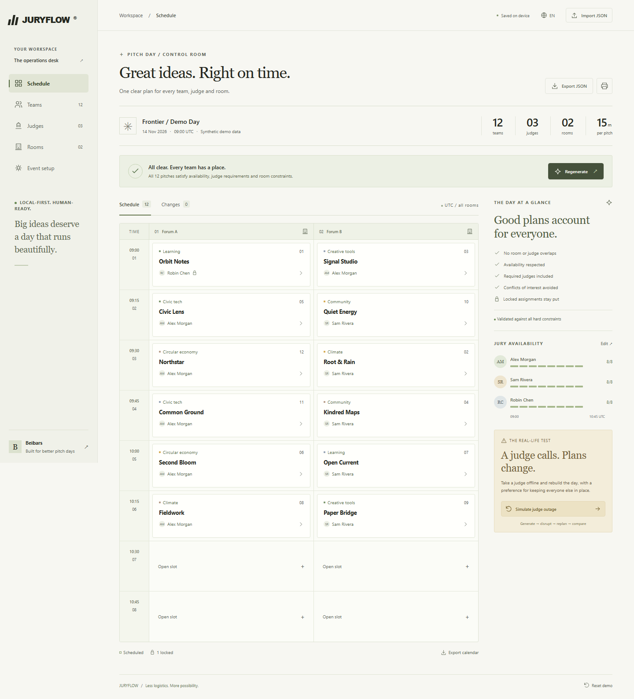

# JURYFLOW

[Independent deep audit and verified repair (23 October 2026)](docs/audit/QA-2026-10-23.md)

**Every pitch, in place.** A scheduling desk for hackathon pitches and university defenses, built for Beibars / [seoshiro](https://github.com/seoshiro).

Teams, judge panels, rooms, availability, conflicts of interest and locked assignments become one usable schedule. When a judge drops out, compare a repaired plan with the original. All demo identities are synthetic.

**[Open the app](https://seoshiro.github.io/juryflow/)** · [One-minute demo](docs/DEMO.md) · [Original QA](docs/QA.md) · [Audit repair regressions](docs/REPAIR-QA.md)



[After a judge outage](docs/screenshots/replan-desktop.png) · [Mobile agenda](docs/screenshots/mobile-agenda.png) · [Capture evidence](docs/screenshots/capture-evidence.json)

## Run locally

Node.js 24 and npm. No API keys, backend, account or environment variables.

```sh
npm ci
npm run dev
```

```sh
npm run typecheck
npm run lint
npm test
npm run test:oracle
npm run build
npx playwright install chromium
npm run test:e2e
npm run preview
```

`npm run verify` runs the full local gate. With a preview server running, `npm run screenshots` captures the real demo states in Chromium.

The production build is `dist/`. It uses relative asset URLs and works at a GitHub Pages project path. `dist/build.json` identifies the exact source commit; CI supplies `GITHUB_SHA`.

## Architecture

- React + TypeScript + Vite. Original responsive CSS, with a room/time grid and a narrow-screen agenda.
- `src/engine/index.ts` is a pure typed scheduling engine. `validateSchedule` checks complete plans independently of search.
- `src/scheduler.worker.ts` isolates search from the UI. The hook terminates workers on cancellation, edits, and stale requests. A five-second outer watchdog bounds worker failure; engine search has a 1.8-second / 120,000-node budget.
- `src/useScheduler.ts` manages local persistence under `juryflow.document.v1`. JSON import is a validated, versioned document boundary. Unsupported versions, broken references and invalid stored schedules are rejected.
- Unfinished local form edits survive reload. If persisted data becomes unreadable, autosave pauses and the primary value stays untouched. The recovery banner offers the original raw download even when a full storage quota prevents a separate backup. Explicit confirmation is required to discard or replace the unreadable event. A storage-read failure also pauses writes; raw download is unavailable when the browser cannot return the value.
- `src/io.ts` produces JSON and UTC iCalendar exports from the same assignments shown on screen. Calendar text is escaped and UTF-8 lines folded. Print CSS renders the current valid schedule.
- No server, tracking, paid service, LLM call or remote personal-data storage. The application works locally after its static files load. This is not an offline-installable PWA.

## Constraints and algorithm

Each team appears exactly once, in an available room and time slot. Its exact panel size, required judges and excluded judges are hard constraints. Rooms and judges cannot appear twice in the same slot. A lock fixes the entire team/slot/room/panel assignment.

The engine validates input and locks, checks necessary capacity conditions, constructs finite candidate domains, and uses deterministic backtracking with constrained teams first and forward checks. With a previous schedule, it tries unchanged assignments first and searches with a change-count bound. A changed team means any difference in slot, room or judge set; all three have equal weight. Added teams have no prior assignment and are not counted as disruptions.

A valid incumbent is returned even if preference search reaches its budget. **Feasible** means every hard constraint was checked. **Infeasible** is returned only after a direct contradiction, a necessary-capacity proof, or exhaustive search. **Unknown** means the bounded search found no plan and did not prove impossibility. **Cancelled** is explicit. Diagnostics describe actual blockers or the exhausted search; they are not claimed to be a smallest conflicting set. A preference proof flag is only true when the search proves the best disruption count. The UI uses conservative wording for replanning.

## Data and limits

- One event, fixed-length slots, one date/start time in **UTC**. Calendar exports preserve UTC. Slots may cross midnight; labels show the day offset.
- Up to 60 teams, 12 judges, 8 rooms and 32 slots; slot length 5–120 minutes. Empty availability is allowed and can make an event infeasible.
- JSON has `schemaVersion: 1`, `project`, `schedule`, `baseline`, and `language`. Only schema fields are retained; unsupported metadata is discarded during normalization. Import source and canonical exported JSON each have the same **2,000,000 UTF-8 byte** limit. The canonical serialized size is checked before replacement, and persistence uses the same serializer. Export a document to keep a backup or transfer browsers.
- Baseline assignments are historical comparison data; current assignments are validated against current constraints. Editing constraints invalidates the current plan until generation succeeds.
- Change counts compare team placement (slot index, room and unordered judge IDs); they do not compare historical wall-clock event timing. Judge IDs are compared as array elements, so commas in valid imported IDs cannot hide a changed panel.
- Core controls switch between English and Russian; some detail helper text and technical constraint diagnostics remain English.

## Tradeoffs and limitations

This is a bounded finite-domain solver, not a commercial optimizer. Larger constrained events may return unknown; reducing the event or relaxing constraints can help. Minimum disruption is a preference and is not promised when search is cut short. No variable-duration talks, travel buffers, judge workload fairness, cross-day sessions, collaborative editing or accounts. Browser storage can be cleared; keep exported backups. JSON is trusted only after validation, but it is not encrypted.

## Quality and deployment

Vitest covers hard constraints, invalid locks, unsatisfiable cases, deterministic output, search limits, document validation and calendar output. Playwright uses an independent constraint oracle on the integrated production build, tests reload, imports, exports, keyboard use and a 390 px viewport, and runs axe accessibility checks. See the checked-in QA report for actual executed results.

The audit repair suite also covers sequential numeric typing, delayed file-read races, native storage quota/recovery, canonical JSON round trips, modal focus return, localized accessible names, worker error dismissal and the 320 px status layout. `npm run test:repair` runs these browser regressions; `npm run test:oracle` repeats the original independent small-event brute-force checks. The [repair report](docs/REPAIR-QA.md) separates reproduced baseline failures from final candidate and live results.

GitHub Actions runs typecheck, lint, unit tests, production build and Chromium E2E before publishing that same `dist/` artifact to GitHub Pages. Public-repository standard Linux Actions and public Pages are available without a paid plan ([GitHub documentation](https://docs.github.com/en/pages/getting-started-with-github-pages/configuring-a-publishing-source-for-your-github-pages-site)). No billing settings are changed.

## Implementation workflow

Four actual roles shared an explicit [file contract](CONTRACT.md): integrator, engine worker, UI worker and independent QA worker. Ownership boundaries avoided concurrent edits to the same files. Local `21st-ui-build` / `21st-ui-review` skills guided design and review; a free 21st catalog lookup failed, so no catalog code or paid generation was used. All screenshots are captured from the actual app.

MIT licensed.
