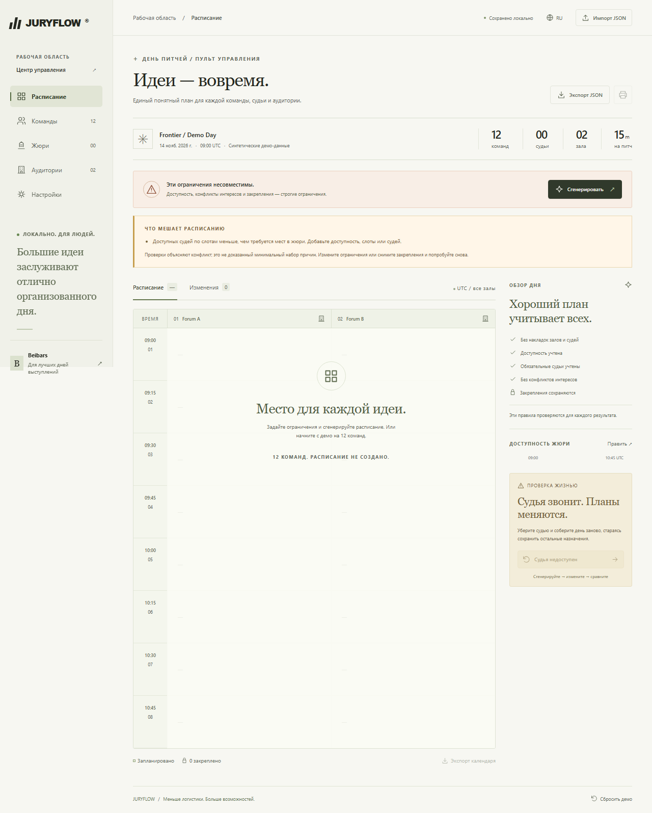

# Independent audit and repair — 23 October 2026

Production: <https://seoshiro.github.io/juryflow/>. Independently verified baseline: `4d85745484ce96c35d523ae6f08b81b7f26c6205`. A separate clean audit clone preserved the original source; no unrelated working tree was overwritten. Four new independent reviewers covered algorithms, security/data, browser UX, and performance/release. The integrator alone changed source and publishes the release.

## Reproduced findings and fixes

| ID / severity | Exact reproduction and baseline actual | Expected / repair / regression |
| --- | --- | --- |
| JF-01 / P3 API | Set all one-team fixture availability arrays to `Array(1)`; `validateProject` returned no issues and `solve` returned `feasible` with `slot === undefined`. `project.judges = Array(1)` instead threw TypeError. JSON cannot represent holes. | Reject malformed data before search. `engine/index.ts` now requires bounded, dense, own enumerable data indexes, including assignment/panel arrays. `tests/audit-boundary.test.ts` covers both false-feasible and throwing paths plus accessors. Independent tests changed 2 FAIL → 2 PASS. |
| JF-02 / P3 import | Set `demoDocument().project.name = 'C1\u0085control'`, serialize and import. Import reported success; solver rejected `invalid-project`. IDs/optional labels had the same mismatch. | Import and solver agree. IO now rejects the entire C1 control range. Regression covers boundaries; independent check covers 132 field/code combinations. |
| JF-03 / P3 export | Export one-team calendars with `(project.id, team.id)` pairs `('audit-a-b','c')` and `('audit-a','b-c')`. Both produced `UID:audit-a-b-c@juryflow.app`. | Distinct identities need distinct UIDs. UID now encodes the JSON tuple, including safe handling of lone surrogates. Distinct-UID regression passes. No external calendar overwrite is claimed; collision was directly observed in exported ICS. Existing imported copies may need removal when switching from old UIDs. |
| JF-04 / P3 UI | In RU, remove all judges and clear required/excluded references, then replan. UNSAT explanation was English. Toggle language: result/explanation disappeared into dirty state; a running solve was also cancelled by the shared document setter. | Localized diagnosis survives presentation changes. A separate language setter preserves worker/result; RU explanation uses issue codes and affected team names. Browser regression covers UNSAT EN↔RU, active worker cancellation, and honest safety timeout. |
| JF-05 / P3 truthfulness | On the same zero-judge UNSAT screen, empty overlay claimed “12 КОМАНД. ВСЁ ПО ПРАВИЛАМ.” regardless of current team count. | Neutral dynamic count and “schedule not generated”; no validity claim before a schedule exists. Browser regression asserts the neutral RU text. |
| JF-06 / P3 feedback | Hold a small worker request, start solve, then Cancel. Worker stopped, but status silently reverted to the untouched start screen. | Explicit localized “Search cancelled. You can try again.” status. The active-worker locale/cancel browser regression protects the acknowledgement. |

Real screenshots: [English diagnosis in RU before](before-ru-diagnostic.jpg), [misleading empty-state claim before](before-empty-state-claim.png), [corrected RU diagnosis and neutral empty state](after-ru-diagnostic.png). These are actual browser captures, not generated images.

Cancel feedback: [before](before-cancel-feedback.png), [after](after-cancel-feedback.png); the worker was stopped in both, while the corrected UI explicitly acknowledges it.

## Evidence and verification

- [Independent exhaustive results](independent-algorithm-results.json): 450 tasks, 163 SAT / 287 UNSAT, 225 minimum-disruption comparisons, 19 locked cases. A separate enumerator checks returned schedules and optimality; no solver domains/validator are reused as the oracle. Bounds and cancellation were also tested.
- Existing seeded repair oracle: 800 tasks, 231 replans, 666 multi-judge cases, 69 locks, 100 deterministic repeats, no failures. Unit suite: 78 tests, plus typecheck/lint/build.
- [Browser audit](browser-final-local.json): fresh isolated Chromium contexts on the user's Windows machine, desktop and 320/390/768, RU/EN, keyboard/focus, dialogs/Escape, JSON round trip, persistence, all editors and narrow dialogs, reduced motion, 720 CSS-pixel reflow, no unexpected JS/console/network errors. All 63 cross-project final-local checks passed; the extra zero-judge path and locale regression passed. Browser tests additionally cover native quota/recovery, delayed imports, worker errors, locks and ICS downloads.
- [Axe after](axe-after-initial.json), [320 EN](axe-after-en-320.json), [320 RU](axe-after-ru-320.json): zero violations in scanned states. Automated checks do not replace assistive-technology user testing.
- [Baseline source/live hashes](source-live-baseline.json): every original built asset, including the worker, matched live bytes. [CI/Pages baseline](ci-pages-baseline.json) confirms successful deployment and no pending release before changes.
- [Measured local performance](performance-baseline.json): demo solve 1.6–11.9 ms; maximum-domain 120k-node budget stopped `unknown` in 204–274 ms. No unmeasured speed improvement is claimed. Large workloads ran locally only.
- [Npm dependency audit](dependency-audit-after.json): zero known advisories at audit time; manifests were sent to the official npm audit service. This is not a proof of complete security.

Reproduce: `npm ci`, `npm run typecheck`, `npm run lint`, `npm test`, `npm run test:oracle`, `npm run build`, `npm run test:e2e`. The [independent cross-project harness](../../scripts/audit-independent.mjs) expects the three repositories as sibling directories, or `AUDIT_REPOS_ROOT` pointing at their parent. Run `node scripts/audit-independent.mjs` from JURYFLOW; it prints seeded results and compiles only into temporary storage.

## Release identity and rollback

The [workflow](https://github.com/seoshiro/juryflow/actions/workflows/pages.yml) now builds a file-hash manifest and, after Pages deployment, rebuilds that exact `GITHUB_SHA`, compares the live manifest and every asset SHA-256, then runs the one-worker E2E suite against production. The [live manifest](https://seoshiro.github.io/juryflow/release-manifest.json) identifies the deployed full SHA; CI run/artifacts provide the release verdict. Source SHA alone is not treated as proof of live assets. Local previews made before commit carry the baseline identifier and are not called a released version.

Rollback reference: baseline SHA above; revert only these audited changes and allow the same verify/deploy pipeline to run. No force push, account/grant/security change, or paid service was used.

## Actual inventory and limits

Applied the installed instruction-only `ecc-windows-engineering` skill (quality/debug, frontend/performance, security/release, Windows), `21st-ui-review` priorities, full-story `verification`, and React review checklist. No ECC runtime/hooks/MCP server was installed or claimed. Read user Codex AGENTS and project design context; these clones contained no AGENTS or `.agents/skills`. Used GitHub MCP metadata, existing Git/gh authorization, PowerShell, Node/npm, Vite/TypeScript/Vitest, Playwright and axe. The `21st` CLI was unavailable; no paid fallback was used. Live Chrome-extension interactions and genuine screenshots supplemented automated browser contexts.

Chromium only: Firefox/WebKit executables were absent. No Safari pass, human screen-reader pass, or native browser-zoom pass is claimed. 720 CSS-pixel reflow was tested; an artificial CSS `zoom=2` experiment was excluded because it does not exercise browser zoom media queries. No production stress/DoS checks ran. A nonblocking P4 remains: a year-9999 event ending in year 10000 cannot be represented by the four-digit ICS date format; use an ordinary event date. The scheduler remains a bounded demonstration, not a certified production optimizer; `unknown` is never presented as UNSAT.
